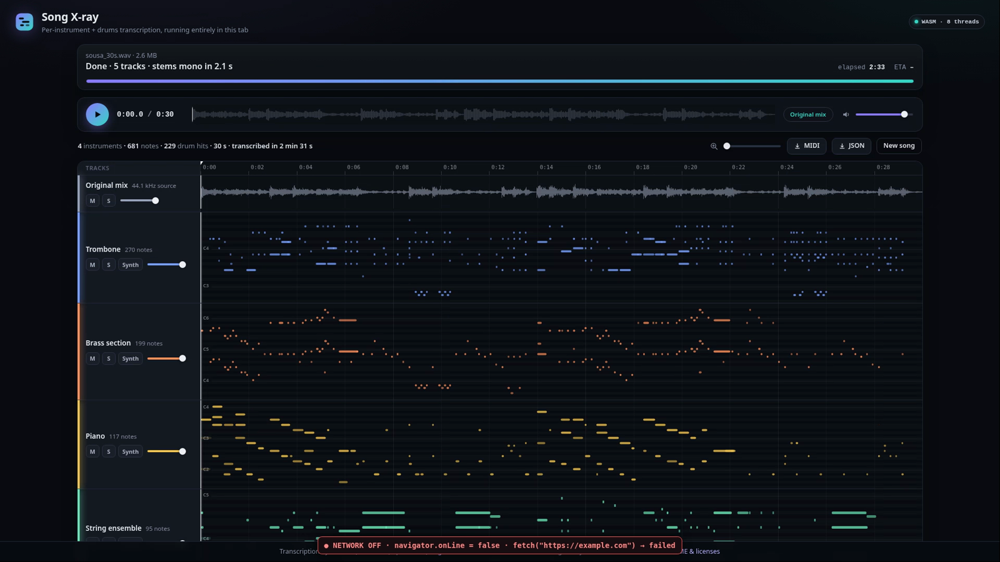

# Song X-ray in a tab

Drop a song (mp3 or wav) onto a web page and get a **per-instrument + drums piano-roll transcription computed entirely
inside the browser tab**. You can then mute or solo each track, or swap any track for a simple WebAudio synth that plays its
notes.

There is no server-side model and no inference API. The page is static files. After `scripts/setup.sh` has put the converted
models next to it, it works with the network switched off.

The transcription is [**Dettato**](https://github.com/kobimusic/dettato) by KobiMusic (Apache-2.0, 28.1M parameters, four
models). Dettato itself is Python/PyTorch only. Its four networks are converted here to ONNX, its non-neural processing is ported
to JavaScript, and everything runs with ONNX Runtime Web (WASM). As far as I know this is the first fully in-tab version of
Dettato-style per-instrument + drums transcription.

> This is a local demo, not a hosted service. It is built to run on your own machine from a local static server.



_A 30 s public-domain recording (U.S. Marine Band, "The Stars and Stripes Forever") transcribed in Chrome with the machine's network cut to loopback only._

## Results at a glance

|                                                            |                                                                                                                                                                                                                                                                                                                                              |
| ---------------------------------------------------------- | -------------------------------------------------------------------------------------------------------------------------------------------------------------------------------------------------------------------------------------------------------------------------------------------------------------------------------------------- |
| **In-tab transcription**                                   | 4 Dettato models (transcriber, evidence repairer, grouper, 4 drum nets) in ONNX Runtime Web WASM, in a Web Worker                                                                                                                                                                                                                            |
| **Parity with the PyTorch original**                       | 18/21 comparisons PASS on 8 clips (see [parity/REPORT.md](parity/REPORT.md)). Every clip up to 60 s passes in every mode, including the real page in Chromium: note F1 ≥ 0.998, drum hits identical, same track names. The 3 failures are track grouping on the full 3½-minute song (see _Limitations_); its notes and drum hits still match |
| **Speed (16-thread desktop CPU, WASM, headless Chromium)** | 24 s clip in 55–65 s · 30 s real recording in 69–80 s · 60 s in 2 min · 3½-minute song in 7–8.5 min: about **2–2.7× real time**                                                                                                                                                                                                              |
| **Offline**                                                | no network requests at all after load (checked in the e2e test); models are served from `web/models/`                                                                                                                                                                                                                                        |
| **Controls**                                               | mute / solo / swap-for-synth per track, original mix, residual, MIDI + JSON export                                                                                                                                                                                                                                                           |

## What's new here

- **An in-browser Dettato.** The four networks (transcriber, evidence repairer, grouper, drum models) are exported to ONNX, and
  all of the reference's glue is ported to plain ES modules in `web/js/`: the HCQT / PCEN / mel front ends with exact FFTs
  (including the drum features' 1411- and 6144-point DFTs), peak picking, the evidence features, the repairer's edit logic, the
  grouper's clustering and naming, and the drum decode. It runs in a Web Worker.
- **A streaming transcriber pass with bounded memory.** The reference keeps whole-song float16 tap buffers (about 10 MB per
  second of audio). The browser version finishes each 8 s block as soon as no later window can touch it, so it holds only a
  sliding ~26 s region (about 270 MB).
- **Chunked whole-song drum attention.** The drum networks are split around their song-level attention, which runs on query
  chunks. A 4-minute song never materialises a T×T matrix in wasm32 memory.
- **Rough stems from the score.** Dettato transcribes but does not separate audio. To make "mute this instrument in the
  original mix" possible, the page builds score-informed soft masks from each track's notes: harmonic combs for pitched tracks,
  and a percussive (HPSS) estimate gated to the drum hits. Unexplained energy goes to a _Residual_ stem. All stems plus the
  residual add back up to the original exactly.
- **A parity harness.** `parity/parity.py` runs the official PyTorch Dettato and this JS/ONNX pipeline on the same clips and
  reports agreement stage by stage. It covers Node (`js-same` with the reference's own samples, and `js` with its own
  decode/resample) and the real page in headless Chromium (`browser`).

## Setup

Requirements: [mise](https://mise.jdx.dev), git, ffmpeg (for the real-clip fetch script, the parity script's mp3 variant and the Node runner's mp3 input), about 1.5 GB of disk. The end-to-end browser test expects Chromium at `/usr/bin/chromium` (override with `--browser`). CPU only: nothing here installs or uses CUDA or GPU wheels.

```bash
scripts/setup.sh      # toolchain (mise), .venv with CPU-only PyTorch, Dettato code + weights (pinned), ONNX export, ORT web assets, clips
npm run serve         # http://localhost:8080  (static files + COOP/COEP headers)
```

`scripts/setup.sh` is idempotent. It runs these steps, each of which can also be run by hand:

| step         | command                                                                                                  |
| ------------ | -------------------------------------------------------------------------------------------------------- |
| toolchain    | `mise install` (Python 3.13.18, uv 0.13.6, Node 22.23.4, `CUDA_VISIBLE_DEVICES=""`)                      |
| Python env   | `uv venv .venv` + CPU wheels from `https://download.pytorch.org/whl/cpu`                                 |
| Dettato code | `git clone https://github.com/kobimusic/dettato vendor/dettato` @ `9b72425`                              |
| weights      | Hugging Face `kobimusic/dettato{,-evidence,-grouper,-drums}` at pinned revisions → `weights/`            |
| convert      | `DETTATO_WEIGHTS=weights .venv/bin/python scripts/export_onnx.py` → `web/models/` (~130 MB, CPU, ~1 min) |
| ORT assets   | `node scripts/copy_ort.mjs` → `web/vendor/ort/`                                                          |
| clips        | `.venv/bin/python scripts/make_clips.py` → `clips/*.wav`                                                 |
| real clip    | `scripts/fetch_real_clip.sh` (optional; public-domain Marine Band recording → `clips/sousa_*`)           |

Raw weights, converted `.onnx` files and the ORT WASM binaries are gitignored. They are large, and the export regenerates them
on CPU with one command.

### Serving

The page needs a static server that sends `Cross-Origin-Opener-Policy: same-origin` and
`Cross-Origin-Embedder-Policy: require-corp`. That makes the page cross-origin isolated, which enables `SharedArrayBuffer`, which
ONNX Runtime Web needs for multi-threaded WASM. `npm run serve` (`scripts/serve.mjs`, no dependencies) does this. A plain
`python -m http.server` also works but runs single-threaded, which is about 5× slower (measured on the transcriber network
under Node: 19 s vs 3.5 s per window with 1 vs 8 threads; not timed in a browser). The page shows which one you got in the badge
at the top right.

Opening `web/index.html` from `file://` does not work, because browsers do not let a `file://` page load WASM or workers that
way.

URL options: `?fast=1` (fast mode on), `?mock=1` (UI with a canned result, no inference), `?webgpu=1` (optional WebGPU
execution provider, untested, see limitations).

## How it works

See [docs/ARCHITECTURE.md](docs/ARCHITECTURE.md) for the module contracts. In short:

```
decodeAudioData at the file's own rate ─► mono ─► resample 16 kHz ─► tuning estimate ─► (retune)
  ─► transcriber: 8 s windows every 2 s, HCQT in JS ─► transcriber.onnx ─► Hann overlap-add (maps + float16 taps)
       per 8 s block, once final: notes ─► evidence (769 numbers / note) ─► repairer.onnx ─► kept / moved / inserted notes
                                  ─► grouper features (12 scalars + 3×368 int8 taps / note)
  ─► grouper: 24 s windows every 12 s, PCEN HCQT in JS ─► grouper.onnx ─► clustering + naming (73 instruments) ─► tracks
  ─► drums (source ≥ 40 kHz): 280 mel/log bands in JS ─► drum-kit net + 3 orchestral experts (+ router) ─► GM drum hits
  ─► page: piano rolls · stems (score-informed masks, Web Worker) · WebAudio player · synths · MIDI / JSON export
```

Long songs are handled by streaming, not chunking. The transcriber pass is one continuous sequence of overlapping windows, as in
the reference, and only the memory is bounded.

## Parity check

```bash
.venv/bin/python parity/parity.py                    # 3 clips + an mp3 and a detuned variant; writes parity/REPORT.md
node tests/e2e/browser.mjs clips/band.wav            # the real page in headless Chromium -> parity/out/band_wav/browser.json
.venv/bin/python parity/parity.py clips/band.wav --browser --no-variants   # include that browser result in the report
```

Per-module tests against the reference's own intermediate arrays:

```bash
.venv/bin/python scripts/dump_fixtures.py clips/band.wav --taps   # (and duet, piano) -> fixtures/
npm test
```

### Results (CPU)

Full report: [parity/REPORT.md](parity/REPORT.md) (generated by `parity/parity.py`).

| clip             | what it is                                                 | reference tracks                                                                                                  | maps max abs diff (js) | pitched-note F1 | track agreement      | drums     |
| ---------------- | ---------------------------------------------------------- | ----------------------------------------------------------------------------------------------------------------- | ---------------------- | --------------- | -------------------- | --------- |
| band.wav         | synth piano + FM bass + flute + drum kit, 24 s             | piano 63, electric bass 43, electric guitar 30, drums 153                                                         | 7.5e-5                 | 1.000           | 1.000                | 153/153   |
| duet.wav         | flute + bass, 20 s (orchestral drum router)                | electric piano 65, electric bass 32                                                                               | 1.7e-5                 | 1.000           | 1.000                | 0/0       |
| piano.wav        | solo arpeggios, 10 s (repairer drops a note)               | electric piano 49                                                                                                 | 4.1e-6                 | 1.000           | 1.000                | 0/0       |
| sousa_30s.wav    | **real recording**: US Marine Band, public domain          | trombone 272, brass section 198, piano 117, string ensemble 94, drums 229                                         | 1.4e-4                 | 0.999           | 0.997                | 229/229   |
| band.mp3         | band as 192 kbit/s mp3 (decoder delay)                     | as band                                                                                                           | 8.6e-5                 | 1.000           | 1.000                | 153/153   |
| band_detuned.wav | band 35 cents sharp (exercises retuning)                   | as band                                                                                                           | 7.6e-5                 | 1.000           | 1.000                | 153/153   |
| sousa_60s.mp3    | **real recording**, first minute, 192 kbit/s mp3           | brass section 312, trombone 329, accordion 165, piano 144, bassoon 188, synth lead 158, drums 470                 | 4.3e-4                 | 0.998–1.000     | 0.994–0.998          | 470/470   |
| sousa_full.mp3   | **real recording**, whole piece, 3 min 34 s, 48 kHz stereo | trombone 940, brass section 869, piano 552, double bass 511, string ensemble 364, harp 203, flute 151, drums 1071 | 5.9e-4                 | 0.995–0.997     | **0.80–0.90 (FAIL)** | 1071/1071 |

The Node modes are **js-same** (the browser pipeline fed the reference's own resampled samples, which isolates models and port)
and **js** (the pipeline doing its own decode and resampling). The **browser** mode is the result the real page produced in
headless Chromium. All three pass on every clip except the full-length song:

- **Transcriber.** Probability maps agree to ≤ 2e-6 (js-same) and ≤ 1.4e-4 (js). Every transcriber note is identical (onset
  and offset within 1 ms) on all clips: 1017/1017 on the real recording.
- **Evidence repairer.** The ONNX graph and torch disagree on a near-tied argmax for 1–3 notes per clip, which moves an onset
  or end by exactly one 5 ms bin. Kept, dropped and inserted notes are otherwise identical (994/994 on the real recording).
- **Grouper.** On the real recording, 1 of 681 notes lands in a different track (trombone vs brass section), and so one
  same-pitch duplicate is merged differently. Track names and counts are otherwise identical. No systematic time offset
  anywhere: the mean onset difference is 0.00 ms.
- **Drums.** Every hit is identical (onset, key, velocity) and the router picks the same model.
- **In the real browser** (`tests/e2e/browser.mjs`, headless Chromium, the browser's own `decodeAudioData`): PASS on band.wav,
  band.mp3 and the 30 s recording. band.mp3 decoded by Chromium gives 152 instead of 153 drum hits (F1 0.997).
- **Full 3½-minute song:**
  - Every transcriber note is identical: 4797/4797.
  - Every repaired note is identical: 4718/4718.
  - Drum hits are identical (1071/1071). An earlier export lost precision here: the orchestral experts' CQ branch reduces
    over the whole song, and onnxruntime's float32 reductions drifted with song length (0.75 in WASM). The export now does
    those reductions in float64, and the experts match torch to 4e-6 on the full song.
  - Track grouping agrees on only 80–90% of notes depending on the mode, and fails the check. See _Limitations_ for the
    cause, and for the evidence that the reference itself is unstable here.

## Limitations

Measured on an AMD Ryzen 7 9800X3D (16 threads, 60 GB RAM, Arch Linux, CPU only) unless stated.

**Speed (WASM, CPU).** In the browser it takes about 2–2.7× the song's length (the spread is machine load):

| input                                         | headless Chromium, 16 WASM threads            | PyTorch reference, same CPU (for comparison) |
| --------------------------------------------- | --------------------------------------------- | -------------------------------------------- |
| 24 s synthetic clip                           | 55–65 s                                       | 37–59 s                                      |
| 30 s real recording                           | 69–80 s                                       | 43–75 s                                      |
| 60 s real recording (mp3)                     | 123 s                                         | 52 s                                         |
| 3 min 34 s real recording (48 kHz stereo mp3) | 420–513 s (7–8.5 min), about 2–2.4× real time | 180–277 s                                    |

- About 90% of the time is the transcriber network, at roughly 3.5–4.5 s per 8 s window (one every 2 s of audio).
- With fewer cores it slows down. On an 8-vCPU Linux VM (Chrome 156, 8 WASM threads) the 30 s recording took about
  2½ min, about 5× real time. With only one thread (no COOP/COEP headers, e.g. `python -m http.server`) expect about 5×
  slower. That figure is from the Node benchmark of the transcriber network; a single-threaded browser run was not timed.
- **Fast mode** (`?fast=1` or the toggle) runs half the windows. On the 30 s recording it took 46 s instead of ~68 s, but it is
  noticeably less faithful (note F1 0.96 against the reference, and one of four tracks merged away). Treat it as a preview.
- **WebGPU:** `?webgpu=1` loads ONNX Runtime's WebGPU build. It is **untested**: this project was built and verified on CPU
  only, by design. It may fall back to WASM per operator or fail on some graphs.

**Memory.**

- The streaming pass keeps the transcriber's tap buffers bounded at about 270 MB, whatever the song length. The probability maps
  grow by about 0.25 MB per second of audio.
- The drum model's whole-song attention runs in query chunks.
- Stems need (tracks + 1) × channels × samples × 4 bytes. Above about 700 MB they are computed in mono, and above about 900 MB
  they are skipped (synth and original playback still work).
- The 3½-minute song peaked at about 1.9 GB (proportional set size of the tab's renderer process, which includes the WASM heap
  holding all models, the tap ring, the stems and the decoded audio).
- Songs much longer than ~10 minutes have not been tried.

**Accuracy vs the Python original.**

- On short and medium clips the port reproduces the reference practically exactly: maps within 1.4e-4, every transcriber note
  identical, drums identical, same tracks (see the parity table above).
- **Long, dense real music is where track grouping diverges.** On the full 3½-minute Marine Band recording, every transcriber
  note (4797/4797) and every repaired note (4718/4718) is identical. Pitched-note F1 is 0.995–0.997 and the drum hits are identical. But
  the grouping into tracks agrees on only 80–90% of notes: the reference's 364-note "string ensemble" track is merged into the
  trombone and other tracks, and in one mode a "french horn" track appears.
- What is established about the cause:
  - The divergence starts in the grouper stage. The JS decode reproduces the reference's groups exactly when fed the
    reference's per-note predictions.
  - Substituting the JS predictions of only the first and last 24 s grouper windows (the ones that include zero-padded audio
    before and after the song) into the reference's predictions reproduces it (`parity/grouper_front_check.mjs`).
  - In those padded frames the JS PCEN front end differs visibly from torch's.
  - Switching the JS PCEN convolution to float64 does **not** recover the reference's tracks. So the exact root cause inside
    those windows is still open.
- The reference's own grouping of this song is also sensitive. With −100 dB dither added to the input, its tracks agree with
  its unperturbed run at 0.936 (one seed: "harp" disappears, "bassoon" appears) and 0.987 (another seed). See
  [parity/STABILITY.md](parity/STABILITY.md).
  - The port agrees with the reference at 0.80–0.90, which is clearly lower than that self-variation.
  - This is a single long song, so treat instrument tracks on long, dense music as approximate.
- The evidence repairer's ONNX graph flips a near-tied argmax for 1–3 notes per clip (onset or end moved by one 5 ms bin).
- A note that lasts more than ~8 s past the end of its 8 s block would be cut by the streaming pass. This never happened in the
  tests (`notesCutAtStreamFrontier` in the result info counts them).
- Browser audio decoding differs slightly from the reference's libsndfile/ffmpeg decode. With Chromium's mp3 decoder, band.mp3
  gave 152 drum hits instead of 153. Resampling uses a Kaiser-sinc fitted to soxr HQ, not soxr itself (max error ~1.5e-4).

**Dettato's own limits apply** (from its README):

- 88 piano keys, at most two notes on one key.
- Instrument names are only roughly right: synthetic test sounds get named "electric piano" or "electric guitar".
- Performance timing, not quantized MIDI.
- No drums for sources below 40 kHz. The page reads the real rate from WAV and MP3 headers. For other formats (flac, ogg, m4a)
  the rate is unknown, so drums are skipped.

**Stems are not source separation.** They are soft masks guided by the transcription: harmonic combs for pitched tracks, and a
percussive estimate near drum hits. Expect bleed between stems on real mixes. "Mute" removes most, not all, of an instrument. The
Residual row holds what no track explains. Stems + residual always add up to the original mix.

**Browsers tested.**

- Chromium 156 (Arch Linux build; headless, software rendering, `--disable-gpu`) via `tests/e2e/browser.mjs`: full end-to-end runs, including the 3½-minute song.
- Firefox 159 (Playwright build, headless) on band.wav: same 4 tracks as the reference (piano 63, electric bass 43,
  electric guitar 30, drums 153) in 67 s, cross-origin isolated, 16 WASM threads, stems computed. Only this clip was run in
  Firefox.
- Google Chrome 156 (headed, under Xvfb, 8 threads) on the 30 s recording, with the network cut to loopback only:
  the same 4 instrument tracks and 229 drum hits as the reference (note counts within 2 per track).
- Not tested: Safari, mobile browsers, real (non-headless) GPU-composited windows. The page needs ES modules in workers and
  `OfflineAudioContext`. Multi-threading needs cross-origin isolation.

**Other.**

- Opening `index.html` from `file://` does not work. Use the bundled server or any static server.
- `setup.sh` needs network once (PyPI, GitHub, Hugging Face, npm). The page itself never does.

## License and credit

- **Dettato** by KobiMusic (Nathan Mills): code and model weights under the Apache License 2.0.
  <https://github.com/kobimusic/dettato> · <https://huggingface.co/collections/kobimusic/dettato>. The converted ONNX models
  are derived from those weights and are covered by the same license. The JavaScript in `web/js/` that ports Dettato's
  processing is a derivative of its Python source. See [NOTICE](NOTICE), [licenses/dettato-LICENSE](licenses/dettato-LICENSE)
  and [licenses/dettato-NOTICE](licenses/dettato-NOTICE). Dettato's model cards note that some of the grouper's and the drum
  model's training datasets carry non-commercial terms. Read them before commercial use.
- **This project**: Apache License 2.0 ([LICENSE](LICENSE)).
- **ONNX Runtime Web** (Microsoft): MIT ([licenses/onnxruntime-web-LICENSE](licenses/onnxruntime-web-LICENSE)), loaded
  locally from `web/vendor/ort/`.
- The synthetic clips in `clips/` are made by `scripts/make_clips.py` (no third-party audio).
- The real-music test recording is downloaded by `scripts/fetch_real_clip.sh`, not committed: _The Stars and Stripes Forever_
  (J. P. Sousa), performed by the United States Marine Band (2017). It is a U.S. federal government work in the public domain
  ([Wikimedia Commons](<https://commons.wikimedia.org/wiki/File:Sousa%27s_%22The_Stars_and_Stripes_Forever%22_-_United_States_Marine_Band_(2017).mp3>),
  from marineband.marines.mil).

If you use Dettato, cite it:

```bibtex
@software{dettato2026,
  title  = {Dettato: multi-instrument audio-to-MIDI transcription},
  author = {Mills, Nathan},
  year   = {2026},
  url    = {https://github.com/kobimusic/dettato}
}
```
